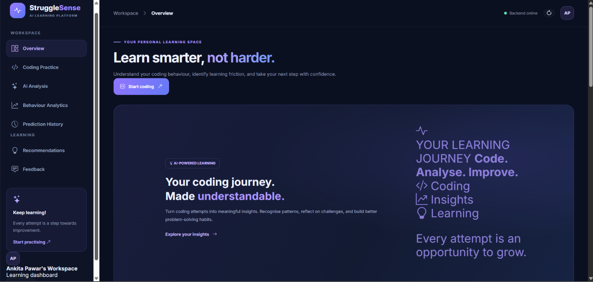
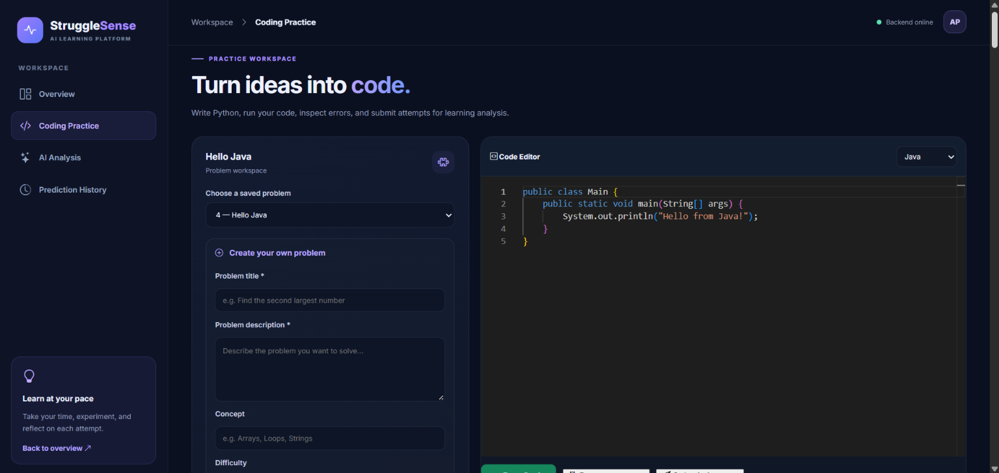
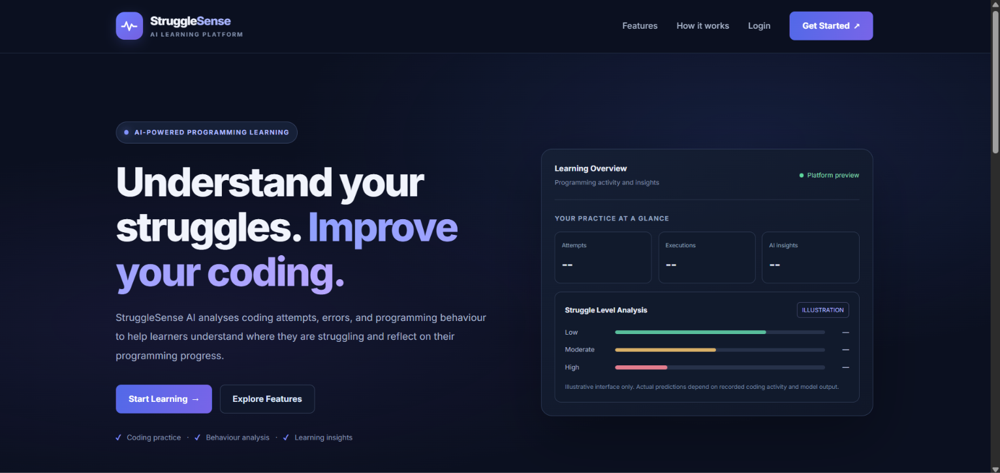
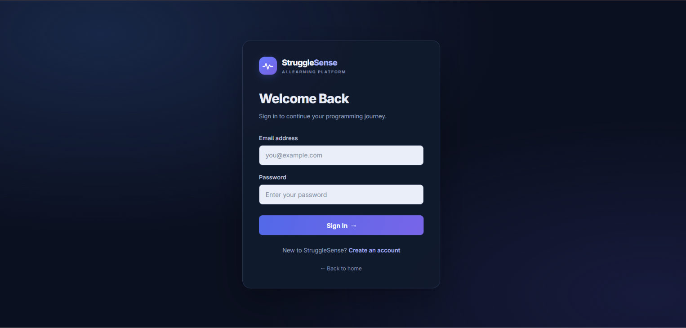

# StruggleSense AI – Programming Struggle Detection

**StruggleSense AI** is a web-based application that analyzes students' coding activity, programming errors, and execution patterns to identify potential programming difficulties and help students improve their coding skills.

## 🚀 Features

- **Student Authentication:** Login and student profile management.
- **Online Code Editor:** Write and execute code in Python, Java, JavaScript, and C.
- **Code Execution:** View program output and execution errors.
- **Struggle Detection:** Analyze coding attempts, errors, execution frequency, and time spent.
- **AI-Based Analysis:** Generate experimental struggle indicators from extracted coding features.
- **Execution History:** Store coding activity and execution records in MySQL.
- **Interactive Dashboard:** View student information, project statistics, and coding activity.

## 🛠️ Tech Stack

| Component | Technologies |
|---|---|
| Frontend | HTML, CSS, JavaScript |
| Backend | Python, Flask |
| Database | MySQL |
| Machine Learning | Python, feature extraction and rule-based analysis |
| Code Execution | Python, Java, JavaScript, C |

## 📸 Screenshots

### Dashboard


### Coding Workspace


### Struggle Detection Results


### Login Page


*Replace or remove any screenshot entry that does not match your actual files.*

## ⚙️ Installation and Setup

**1. Clone the repository**

```bash
git clone https://github.com/ankitapawar27/programming-struggle-detection.git
cd programming-struggle-detection
```

**2. Install dependencies**

Activate your Python virtual environment, then install the required packages:

```bash
pip install -r requirements.txt
```

**3. Configure the database**

Create the `programming_struggle_detection` database in MySQL and configure the database credentials in your local environment.

**4. Start the backend**

```bash
python -m backend.app
```

**5. Start the frontend**

Open the project using VS Code Live Server and navigate to the appropriate frontend page.

Ensure the required language runtimes (JDK, Node.js, and GCC) are installed for Java, JavaScript, and C execution.

## 🎯 Objective

To identify potential programming difficulties through coding behavior analysis and provide insights that can support students during programming practice.

## ⚠️ Limitations

The struggle detection system is an experimental prototype. Its indicators are not a clinically or scientifically validated measure of student difficulty. The code execution feature is intended for trusted local testing and requires additional security controls before public deployment.

## 👩‍💻 Developed By

**Ankita Pawar**

B.Sc. Computer Science | Third Year

GitHub: [ankitapawar27](https://github.com/ankitapawar27)
